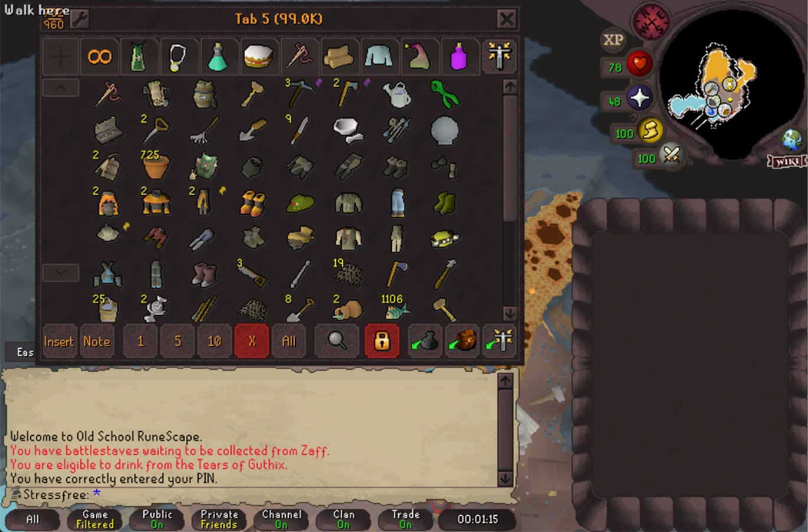

# 2005 Noctis Bordo

GNASH0R's [2005](https://github.com/melkypie/resource-packs/tree/pack-2005) interface, recoloured to the **Bordo** variant of the [Noctis](https://github.com/liviuschera/noctis) colour scheme for the RuneLite [Resource Packs](https://github.com/melkypie/resource-packs) plugin, with the chat parchment in Noctis **Lux** creams. Built for the Resizeable layout.

No sprite is redrawn. The 2005-specific art keeps its original shapes, shading and transparency and only the colours change, while the standard buttons and stones are the same recoloured vanilla sprites as the [Vanilla Noctis Bordo pack](https://github.com/opher290/bordo-resource-pack), so the two sit side by side seamlessly. The compass dial keeps its original red-to-orange gradient, with a wine rim and a yellow-orange centre, and icons are left exactly as the original author drew them.

**Why is the chatbox light?** The chatbox is deliberately not dark. It is inspired by Noctis **Lux**, the light Noctis variant, so the chat parchment uses Lux's warm cream (`#e6d7b2`) and the Bordo wine, red and blue chat text sits on it with good contrast, while the rest of the interface stays on the dark Bordo rose-greys.

## Screenshots

## Installation

Install the **Resource packs** plugin from the Plugin Hub, then install this pack from its hub. To use the 2005 interface style correctly, follow GNASH0R's setup from the original 2005 packs:

1. Go to RuneLite's plugins, enable **Interface Styles**, open its settings and set `Gameframe` to `2005`.
2. Go to the **Resource packs** plugin settings and tick the experimental setting at the bottom, `Don't change Interface Styles`.
3. Disable and re-enable the Resource packs plugin, and you're done.

If you want to use other packs afterwards, make sure to disable the **Interface Styles** plugin and disable/re-enable Resource packs for them to work correctly, unless their creators specify otherwise.

As the original notes, 2005 can't match the original exactly in Resizeable mode because of the plugin's limits.

### Recommended layout

Set **Game client layout** to **Resizable - Classic layout** (Settings > Display Settings). This pack is built for it.

- **Resizable - Modern layout** works, but it doesn't look its best. Interface Styles' 2005 gameframe and the 2005 sprites are placed for the classic layouts, so in Modern the tab icons don't sit centred on their stones.
- **Fixed - Classic layout** isn't supported yet. A Fixed - Classic version may come in the future.

## Chat colours

On the opaque chatbox this pack recolours the chat text to the Bordo palette:

| Text | Colour |
| --- | --- |
| Public chat, channel names, examine highlights | `#1b4f78` |
| Private messages, friends / clan / guest clan chat messages | `#8f2a1c` |
| Game and examine highlights | `#e97749` |
| Friends / clan / guest clan info highlights | `#8c2f45` |
| Private message highlights | `#174a73` |
| Game, server, examine and info text, other highlights | `#272022` |

The transparent chatbox keeps its default colours. If you prefer your own chat colours, turn off **Allow chat colors to be changed** in the Resource packs plugin settings.
## What changes

| Area | Source |
| --- | --- |
| Buttons, tab stones, bank, scrollbars, checkboxes and sliders, GE, equipment slots, dialog panels | Taken as-is from the [Vanilla Noctis Bordo pack](https://github.com/opher290/bordo-resource-pack), so they match it exactly |
| Side panel, tab rows, minimap frame, window edges, the black steel dialog borders, chat buttons | The original 2005 art recoloured to the Bordo rose-greys (`#1a1516` through `#33292a` to `#a88a86`), darkened to the Vanilla Noctis Bordo pack's tone |
| Chat parchment | Lifted onto the Lux cream `#e6d7b2`, keeping the original shading and torn edges, with the dark outline of the tear blended almost fully into the cream so the edge is seamless |
| Compass dial | Keeps the original smooth gradient, from a Bordo wine rim (`#84303f`) through red-orange to a yellow-orange `#f2b13e` centre |
| Overlay, borders and separators | The Vanilla Noctis Bordo pack's `vars.toml` and `overrides.toml`, unchanged |
| Selected tab stones | GNASH0R's own chamfered selected stones, tinted to brick red #8f3f2a and keeping their shape, shading and outline |
| Emote plates, and the grey squares behind the equipment stats, prices, items-lost, call-follower, sailing options and combat options icons | The original grey-olive plates moved onto the Bordo rose-greys; the yellow and green labels and the icon art stay as drawn |
| Bank PIN screen | The red marble buttons tinted to Bordo wine red `#8c2f45`, keeping the bevel and texture; the olive marble behind Exit / I don't know it moved onto the Bordo rose-greys |
| Seven tab icons: Chat-channel, Clan, Guest clan, the three group ironman tabs and Red minigames | Blank in the original; taken from the [2005 Overhaul](https://github.com/melkypie/resource-packs/tree/pack-2005-overhaul) pack by Demonseance, as drawn; only the Chat-channel icon is moved 5px right and 2px down to sit in its corner stone |
| Inventory, friends, stats, combat, equipment, prayer, emotes and music tab icons | GNASH0R's icons with the black drop shadow evened out to match the Quests and Friends icons: the same solid black shadow, two pixels deep and down and to the right (the angle of the settings wrench), added to the stats, combat, equipment, prayer and emotes icons, a little thinned on the inventory bag and the friends and ignore smileys, and a single soft row on the music harp |
| Other icons and quest art | Left exactly as the original author drew them |

## Related packs

- [Vanilla Noctis Bordo](https://github.com/opher290/bordo-resource-pack): the vanilla-interface version of this palette.
- [2005 Gruvbox Dark](https://github.com/opher290/gruvbox-2005-resource-pack): the same 2005 approach on a warm grey palette.

## Building it yourself

`tools/build.ps1` regenerates the pack from a checkout of the original (`pack-2005`):

- `recolor.ps1 -Scheme bordo` recolours the shell sprites onto the Bordo ramp (`schemes.ps1`). The 2005 stone is about twice as bright as vanilla's, so with `-RefSrc` (the vanilla sample pack, passed as `-Vanilla` to `build.ps1`) each sprite is darkened to its vanilla counterpart's tone. `-MainPack` is a checkout of the main Bordo pack: its buttons, stones, bank, scrollbars, options, GE, equipment and dialog sprites are used as-is, and it fills anything the original leaves out.
- `tonematch.ps1` nudges the recoloured frames onto the Vanilla Noctis Bordo pack's exact tone, `compass.ps1` recolours the compass dial, `chatedge.ps1` moves the chat parchment's burnt edge onto the Bordo ramp, `chatfill.ps1` lifts the parchment onto the Lux cream and softens the tear outline, `emote.ps1` and `iconbg.ps1` move the emote and icon-button plates onto the ramp, `pin.ps1` tints the bank PIN screen, `shadow.ps1` evens out the tab icon drop shadows, `stone.ps1` tints the selected-tab stones to brick red, and `icon.ps1` builds `icon.png`.

## Credits

All credit for the base goes to **GNASH0R**, whose [2005](https://github.com/melkypie/resource-packs/tree/pack-2005) pack provides the interface art, layout and icons, and to the [Resource Packs](https://github.com/melkypie/resource-packs) plugin by melkypie. This pack only recolours (filters) that work and applies a few minor fixes; no sprite is redrawn.

- **GNASH0R** for the [2005 pack](https://github.com/melkypie/resource-packs/tree/pack-2005) this is based on: the interface art, layout and icons.
- **Demonseance** for the [2005 Overhaul](https://github.com/melkypie/resource-packs/tree/pack-2005-overhaul) pack, whose icons fill seven tab icons the original leaves blank (Chat-channel, Clan, Guest clan, the three group ironman tabs and Red minigames).
- **melkypie** for the [Resource Packs](https://github.com/melkypie/resource-packs) plugin and the vanilla sample pack.
- [Noctis](https://github.com/liviuschera/noctis) by Liviu Schera for the Bordo and Lux colour schemes.
